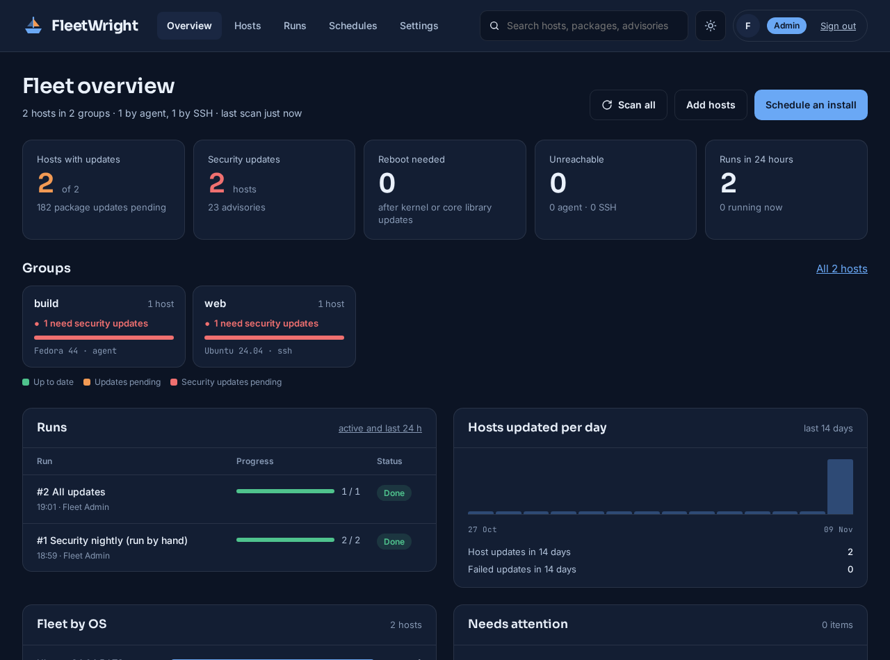

# FleetWright

[](https://github.com/chrisnock-personal/fleetwright/actions/workflows/ci.yml)

**FleetWright** keeps a fleet of Ubuntu and Fedora servers up to date. It
reaches each host either through a small **agent** (a Python service that
connects out to FleetWright) or **agentless over SSH** with a stored key, and
runs the same update code either way. From one dashboard you can see what's
pending across the fleet, install updates by hand, book an install for a
maintenance window, or let **auto-install policies** apply chosen kinds of
update (security, kernel, bug fixes, enhancements) on a schedule. Every
package change is recorded.

Built for hundreds to thousands of hosts: Postgres is the job queue, workers
scale out, agents scan themselves, and updates roll out in batches with a
canary and a failure limit.

For an illustrated tour of every feature, see the
[project overview](https://github.com/chrisnock-personal/project-overviews/blob/main/fleetwright/README.md).



## Quick start

```bash
cp .env.example .env
# set FLEETWRIGHT_SECRET_KEY (openssl rand -hex 32) and FLEETWRIGHT_PUBLIC_URL
docker compose up -d          # or podman-compose up -d
docker compose logs web       # shows the one-time setup code
```

Open `https://<host>:8443`. The certificate is self-signed on first start, so
the browser warns once: check that the fingerprint matches the one in the
`web` log, then enter the setup code and create the first admin. Then:

1. **Settings → SSH keys**: generate or paste a key for agentless hosts.
2. **Hosts → Add SSH hosts**: one per line, `name address[:port]`.
3. Or **Settings → Agents**: create an enrolment token and run the install
   command it shows on each host.

Ports: 8443 serves HTTPS (dashboard and agent gateway), 8080 only redirects
to it. Both are bound to localhost unless `HTTPS_EXPOSE` / `HTTP_EXPOSE` say
otherwise.

## How it works

```
 browser ──https──▶ web (FastAPI, Jinja)  ◀──wss── agents (Python, systemd, root)
                      │   agent gateway              scan on a timer, run tasks
                      ▼
                   Postgres  ◀── worker(s): SSH tasks, schedules, batches, scans
                      (hosts, pending updates,        │
                       runs, tasks, history,          └─ssh──▶ agentless hosts
                       policies, bookings)                     sudo python3 - <op>
```

- **`pkgops.py`** is all the apt/dnf work in one standard-library-only file:
  scan, choose, install, check for a reboot, reboot. The agent imports it;
  for SSH hosts the worker pipes the same file to `sudo -n python3 -`. Ubuntu:
  `apt-get -s upgrade --with-new-pkgs`, security from the `-security` pocket.
  Fedora: `dnf check-upgrade` plus `dnf advisory list --json` for type and
  severity, `dnf needs-restarting -r`.
- **Runs and tasks**: a run is split into one task per host, in batches (an
  optional canary host first). The worker opens the next batch when the
  current one finishes, stops when the failure limit is hit, and starts no
  new host once a maintenance window closes. Workers claim tasks with
  `FOR UPDATE SKIP LOCKED` and are woken by `NOTIFY`, so you can run several.
- **Agents** keep one WebSocket open; they need no inbound port. They scan
  every `FLEETWRIGHT_SCAN_INTERVAL_MIN` (with jitter) and run only the
  operations pkgops offers, never arbitrary commands.
- **Selections**: everything; chosen kinds (security with a minimum
  severity, kernel, bug fixes, enhancements) plus include/exclude patterns;
  or specific packages pinned to the version seen when they were picked.
  Each host's own "never install" list always applies. Every install rescans
  first.
- **Other updaters**: each scan checks whether `unattended-upgrades` (on by
  default on Ubuntu) or `dnf-automatic` installs updates by itself, since
  anything it installs during a FleetWright run would be recorded as
  FleetWright's. Such hosts are flagged on their page and under *Needs
  attention*, and *Turn off* stops them: on Ubuntu by writing
  `/etc/apt/apt.conf.d/99fleetwright-no-unattended-upgrades` (delete it to
  undo), on Fedora with `systemctl disable --now` on the timer (`enable --now`
  to undo). Agents older than 0.2.0 don't report this; reinstall them.

## Scheduling

- **Auto-install policies**: which kinds of update, which hosts (groups, tags,
  all; minus excluded tags), daily, weekly or monthly in a window, how many
  hosts at a time, when to stop, and whether to reboot. Each has an on/off
  switch and a preview of what it would install right now.
- **One-off installs**: tick hosts or updates and choose *Schedule…*, or use
  *Schedule an install*. Optional admin approval; if the window opens
  unapproved, it's missed rather than run.

## Notifications

**Settings → Notifications** sends a message by email (SMTP), webhook or
[ntfy](https://ntfy.sh) when a run fails, stops early or misses its window, a
host stays unreachable (for 30 minutes by default) and when it's back, a booked
install needs approval, or a critical security update appears; optionally also
when a run finishes cleanly. Each channel picks its events and has a *Send
test* button. Messages that pile up for a channel within a few seconds go out
as one, so an outage across many hosts is one message. A failed send is
retried with a growing delay for about four hours, and the channel shows the
error. Webhooks get a JSON POST whose `text` field also makes it a Slack or
Mattermost message; with a signing secret, each carries
`X-FleetWright-Signature: sha256=<HMAC-SHA256 of the body>`. ntfy messages
about problems are high priority. Passwords, secrets and tokens are stored
encrypted. Links in messages use `FLEETWRIGHT_PUBLIC_URL`.

## Backups and the secret key

An opt-in `backup` service saves the database and the HTTPS certificate and
key once a day (and at its first start), encrypted with
[age](https://age-encryption.org) to public keys only, so whoever holds the
server can make backups but not read them. The certificate is in it because
agents trust exactly this server's key: a server restored without it would
mean enrolling every agent again.

1. On another machine: `age-keygen -o fleetwright-backup.key` (an SSH key
   works too). Keep it, with a copy of `FLEETWRIGHT_SECRET_KEY`, off the server.
2. In `.env`: `BACKUP_AGE_RECIPIENTS=age1…` (its public key; several,
   comma-separated), and optionally `BACKUP_AT` (03:30 UTC), `BACKUP_KEEP` (14)
   and `BACKUP_DIR` (`./backups`). Copy that directory off the host too.
3. `docker compose --profile backup up -d`. One now:
   `docker compose --profile backup run --rm backup now`.

**Settings → Backups** shows the last backup, and the "backup" notification
event reports a failed backup or none for over a day. To restore, on the new or
repaired server with the old `.env`:
`backup/restore.sh fleetwright-….tar.age fleetwright-backup.key`. It replaces
the database and the certificate, then starts FleetWright; agents reconnect by
themselves.

`FLEETWRIGHT_SECRET_KEY` encrypts stored SSH keys and notification secrets. To
change it, put the new key in `FLEETWRIGHT_SECRET_KEY`, the old one in
`FLEETWRIGHT_SECRET_KEY_PREVIOUS`, and restart: FleetWright re-encrypts
everything under the new key and says so in its log, after which the old key
can go from `.env` (everyone signs in again). Keep the old key with the
backups made before the change: restoring one of them needs it in
`FLEETWRIGHT_SECRET_KEY_PREVIOUS` again. If the key changes without the old
one, FleetWright says so to admins on every page rather than failing later on
each SSH connection.

## Updating agents

Agents from 0.3.0 on update themselves when told to. A host whose agent isn't
the one this server hands out shows *Update to …* on its page, the hosts list
has an *Agent outdated* filter, and **Settings → Agents** has an *Update N
agents* button. An update is a normal run: one host first, then a tenth of
them at a time, stopping at the first failure. Each agent fetches its two
files over its own verified HTTPS connection, checks each against the SHA-256
the server sent over the WebSocket, refuses any other file name and an agent
that doesn't compile, swaps them in and exits for systemd to start the new
one. The task finishes when the agent reconnects as the new version, and fails
if it hasn't within `FLEETWRIGHT_REBOOT_WAIT`; there is no automatic rollback,
so a host whose new agent won't start needs the install command run again.
Agents older than 0.3.0 can't update themselves: run the install command on
them once.

## API

Everything the pages can do is also at `/api/v1` as JSON, with the same roles.
Make a token on your **Account** page (click your name), then:

```bash
curl -H "Authorization: Bearer fwt_…" https://fleetwright:8443/api/v1/hosts?status=security
```

Runs return their id at once and can be followed live with Server-Sent
Events, and retries are safe with an `Idempotency-Key`. Reference, examples and
every endpoint with its role: [docs/api.md](docs/api.md), and
`/api/v1/docs` on your own server.

**`fw`**, the command-line client, wraps it: `pipx install ./cli`, then
`fw login --url https://fleetwright:8443` and, for example,
`fw run apply --group web --kinds security --batch 10% --canary --yes --wait`.
JSON output, stable exit codes and `--dry-run` make it safe to script, or to hand
to an AI agent with a viewer token. See [cli/README.md](cli/README.md).

## Agentless hosts

FleetWright connects as the key's user and runs `sudo -n python3 -`, sending
the update script on standard input:

```bash
useradd -m -s /bin/bash fleetwright
install -d -m 700 -o fleetwright -g fleetwright ~fleetwright/.ssh
echo 'ssh-ed25519 AAAA… fleetwright-prod' >> ~fleetwright/.ssh/authorized_keys
chown fleetwright: ~fleetwright/.ssh/authorized_keys
echo 'fleetwright ALL=(root) NOPASSWD: /usr/bin/python3' > /etc/sudoers.d/fleetwright
chmod 440 /etc/sudoers.d/fleetwright
```

Running Python as root is as good as root, so treat that key like a root key.

## Security

- **HTTPS by default**, self-signed on first start (naming the host in
  `FLEETWRIGHT_PUBLIC_URL` and `FLEETWRIGHT_TLS_NAMES`). **Settings → HTTPS**
  shows the fingerprint, takes your own certificate and key (checked first;
  the old pair comes back if the new one won't load) or makes a new
  self-signed one. `FLEETWRIGHT_TLS=off` serves plain HTTP for a TLS proxy.
  Session cookies are HTTPS-only whenever TLS is on.
- **Agents verify the server during the TLS handshake**, before sending their
  token. The install command pins the server's public key
  (`curl --pinnedpubkey`), and the agent trusts the exact certificate it
  enrolled with, plus the system CAs. When the certificate changes, connected
  agents are sent the new one over their existing connection first. Agents
  refuse plain `http://`/`ws://` unless enrolled with `--insecure`.
- **SSH host keys are pinned** on first contact. After that only the pinned
  key is accepted in the handshake, so a host offering a different key is
  refused before FleetWright authenticates or sends anything. *Forget pinned
  host key* on the host page clears it after a deliberate rebuild.
- **Secrets**: SSH private keys and notification secrets are encrypted
  (Fernet, from `FLEETWRIGHT_SECRET_KEY`); agent tokens, enrolment tokens,
  API tokens and setup links are stored only as SHA-256 hashes; passwords use
  Argon2.
- **Accounts**: no default password. The first admin needs the setup code
  from the log; others get single-use setup links. Roles: admin, operator,
  viewer, checked in one place for the pages and the API alike. Every change
  is in the audit log.
- **API tokens** act with their person's role or a lower one, can expire and
  be revoked, and are rate-limited. The API accepts only tokens, never the
  session cookie, so other sites can't use a signed-in browser.
- Not yet: the Postgres connection inside the compose network is
  unencrypted, and the database volume isn't encrypted at rest (backups are,
  with age).

## Configuration

See `.env.example`. The worker also takes `FLEETWRIGHT_SSH_CONCURRENCY` (50),
`FLEETWRIGHT_SCAN_INTERVAL_MIN` (360), `FLEETWRIGHT_TASK_TIMEOUT` (3600 s) and
`FLEETWRIGHT_REBOOT_WAIT` (600 s).

## Development

```bash
python3 -m venv .venv && .venv/bin/pip install -r requirements-dev.txt
.venv/bin/python -m pytest -q
```

`requirements.txt` has the version ranges; the image installs `requirements.lock`,
the exact versions resolved from them inside the image's base and checked with
`pip-audit -r requirements.lock --no-deps --disable-pip`. Its header says how to
refresh it. The agent and `fw` need nothing from PyPI.

`tests/integration/run.sh` (Docker or podman, in a scratch copy) builds and starts
the whole stack, runs the API smoke test against SSH hosts, installs the agent into
Ubuntu 24.04 and Fedora 44 systemd containers with the real install command, scans
them with real apt and dnf, drives them with `fw`, and loads every page.
[CI](.github/workflows/ci.yml) runs it on every push, with the unit tests,
`pip-audit` of `requirements.lock` (also weekly) and `gitleaks` over the whole history.

Tested against Ubuntu 24.04 and Fedora 44 cloud images.

## Licence

MIT: see [LICENSE](LICENSE). FleetWright is fully open source.
